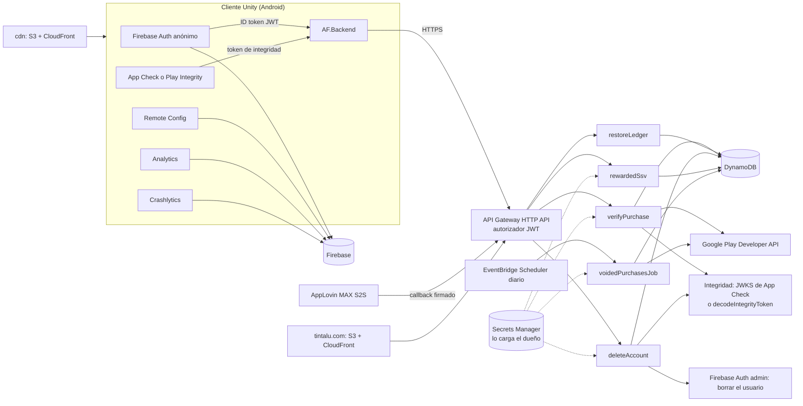

# Plan del backend en AWS (D-035)

Fecha: 2026-10-20. Lo preparó el tech-lead sobre `integracion-fase1-fase2` en `732c76d` y lo guarda el integrador. **Es una propuesta:** nada se instala ni se despliega hasta que el dueño responda las preguntas de la sección 10 y apruebe la herramienta, los paquetes y los límites de los agentes (regla 4 de `CLAUDE.md`). Ningún agente ve claves de AWS ni de Google (regla 5).

**Leyenda:** [P] propuesta · [E] estimación · [NV] sin verificar (lo confirma la tarea F0-R).

---

## 0. Hallazgos que condicionan el plan

1. **Ningún agente tiene `infra/` entre sus archivos.** `sdk-integrator` solo tiene `functions/**` «cuando el dueño abra esa fase» y `build-release` no tiene `infra/`. Ampliarlos lo aprueba el dueño (Q-AWS-2).
2. **Sin app en Play Console no se pueden probar de verdad ni las compras ni Play Integrity.** D-034 aplaza crear la app hasta el dictamen de marca; un APK instalado a mano da `UNRECOGNIZED_VERSION` [NV]. En dev se prueban con verificadores falsos que solo existen en el stack de dev (§9, F4-3).
3. **D-035 choca con 08 §6.2.** D-035 pone el «arte de mundos» en el CDN, pero 08 §6.2 lo deja en Play Asset Delivery on-demand, que aloja Google gratis. Se recomienda CloudFront solo para `levels_remote` y el catálogo, y el arte en PAD (Q-AWS-8).
4. **Hay una vía más barata que «Play Integrity en lugar de App Check».** El SDK de App Check ya está aprobado en Firebase 13.17.0 (08 §7 #4) y su token es un JWT que se puede verificar en AWS con las claves públicas de Firebase [NV]. Por debajo sigue siendo Play Integrity, sin paquete nuevo y con la cuota amortizada. Es la recomendada de Q-AWS-4 y reinterpreta el texto de D-035.
5. **El SSV de 08 §10.2 necesita una pieza nueva.** El cliente confirmaba los nonces leyendo Firestore; en AWS hace falta un endpoint. Se propone meterlo en `restoreLedger` para seguir con 5 funciones [P].

---

## 1. Arquitectura objetivo



**Autorización con Firebase Auth.** El autorizador JWT nativo de la HTTP API valida el ID token (`iss = https://securetoken.google.com/<project-id>`, `aud = <project-id>`, RS256 con las claves de `securetoken@system.gserviceaccount.com`, descubiertas por OIDC [NV]). La Lambda recibe el `sub` (UID) ya validado. Las rutas S2S (`/v1/ssv`) y las de la web (borrado por código) no pasan por el JWT y se protegen como en §2.

**Integridad.**
- (a) Recomendada: token de App Check «de uso limitado», verificado en la Lambda con `jose` contra el JWKS de App Check [NV].
- (b) Token estándar de Play Integrity, decodificado con `playintegrity.googleapis.com/v1/{package}:decodeIntegrityToken`; necesita la cuenta de servicio y el proyecto de Google Cloud vinculado en Play Console.
- Solo se exige en `verifyPurchase` y en `deleteAccount` desde la app. El veredicto se guarda por UID 24 h [P] (tabla `af-<env>-integrity`, con TTL).
- Cuota: 10.000/día gratis por app (08 §7 #6). Con integridad solo en compra y borrado no se pasa ni con 1 M de MAU [E]; F5-4 pone una alarma al 70 %.

**Recompensas por anuncio (SSV).** El callback S2S de MAX va a `POST /v1/ssv`, con `user_id = UID` y `custom_data = placement|nonce` (08 §10.1); el secreto, en Secrets Manager [NV: formato del hash de MAX]. La SSV directa de AdMob (ECDSA) solo si AdMob llama sin pasar por MAX [NV].

**Google Play Developer API.** `purchases.products.get` y `acknowledge` [NV si conviene `productsv2`]; `voidedpurchases.list` en el job diario. Cuenta de servicio con permiso de pedidos en Play Console; su clave JSON vive en Secrets Manager y la carga el dueño. Alternativa sin clave larga: Workload Identity Federation (Q-AWS-7).

---

## 2. Servicios de AWS por pieza

| Pieza | Servicio | Configuración [P] |
|---|---|---|
| API | **API Gateway HTTP API** (las Function URLs no tienen autorizador JWT ni límites por ruta) | Autorizador JWT; límites por ruta (p. ej. 50 rps y ráfaga de 100; 2 rps en `/v1/account/delete-*`); `api.<dominio>` en prod; en dev, la URL de `execute-api` |
| Funciones | **Lambda** arm64, runtime `nodejs24.x` o el LTS que soporte AWS [NV] | 256 MB, 10 s (el job, 5 min); una función por pieza de 08 §2.4; bundle con esbuild |
| Datos | **DynamoDB on-demand**, cifrado, PITR en el libro mayor y protección contra borrado en prod | Tablas abajo |
| Job diario | **EventBridge Scheduler** (03:00 UTC) con reintentos y DLQ en SQS | Checkpoint `startTime` en `af-<env>-jobs` |
| Web | **S3 privado + CloudFront (OAC) + ACM (us-east-1) + Route 53** | Cabeceras de seguridad, TLS 1.2+, `app-ads.txt` en la raíz |
| CDN | Otra distribución CloudFront + bucket `af-<env>-content` | `packs/<content_version>/…` inmutables con caché larga; `catalog.json` con TTL de 5 min |
| Abuso | Límites de API Gateway + **límite en DynamoDB** (contador por hash de IP y de código, con TTL); **WAF** opcional en prod (la HTTP API no admite WAF directo [NV]; iría en un CloudFront delante) | Q-B13-21: código de borrado aleatorio de 128 bits, distinto del UID; solo se guarda su hash |
| Observabilidad | **CloudWatch**: logs con 30 días de retención y el UID solo como hash | Alarmas: errores y throttles de Lambda, 5xx de la API, fallo del job, throttles de DynamoDB, cuota de integridad; aviso por SNS al correo del dueño |
| Coste | **AWS Budgets** | Dev 10 USD y prod 50 USD al mes, avisos al 50, 80 y 100 % [P] |
| Secretos | **Secrets Manager** | El CDK los crea vacíos; el dueño hace `put-secret-value` |

**Tablas** (prefijo `af-<env>-`, sin la marca):

| Tabla | Clave | Atributos | Notas |
|---|---|---|---|
| `purchases` (libro mayor) | PK `token_hash` (SHA-256 del `purchaseToken`) | `uid`, `sku`, `order_id`, `ts`, `price_micros`, `currency`, `country`, `state ∈ {ok, voided}`, `voided_at` | `PutItem` condicional = idempotencia (`duplicate`), dentro de una transacción con la comprobación de cuenta no borrada (F2c). GSI disperso `by_uid (uid, ts)` para `restoreLedger`. Al borrar la cuenta se quita `uid`: la fila sale del GSI y se conserva anonimizada el plazo fiscal. Lápida `voided` sin `uid` (`tombstone: true`) para los tokens anulados en Play antes de verificarse (F2c): `verifyPurchase` responde 400 |
| `rewards` | PK `nonce` | `uid`, `placement`, `network`, `ts`, `ttl` (30 días [P]) | La condición rechaza un nonce repetido; GSI `by_uid` |
| `integrity` | PK `uid` | `verdict`, `ttl` (24 h) | Caché del veredicto |
| `account_codes` | PK `code_hash` | `uid`, `created_at`; GSI `by_uid` | Borrado por web (Q-B13-21) |
| `rate_limits` | PK `key` (hash de IP o de código + ventana) | `count`, `ttl` | Límite de peticiones; marcas de un solo uso, de cuenta borrada (`deleted#`, 2 h) y `once#<sku>#<hash del UID>` de los SKU `once_per_account` (`af_starter`; sin TTL, la borra el borrado de cuenta; F2c) |
| `jobs` | PK `job` | `cursor` | Checkpoint de las compras anuladas |

**Región recomendada: `sa-east-1` (São Paulo)** para la API, Lambda y DynamoDB; `us-east-1` solo para ACM y WAF de CloudFront y para Budgets. Motivo: los datos de Brasil se quedan en Brasil (LGPD) y la latencia es menor desde BR, CO y PE [E]. Cuesta unos 30-60 % más que `us-east-1` [NV], irrelevante con este volumen (§6).

---

## 3. CDK frente a Terraform

| Criterio | CDK v2 (TypeScript) | Terraform u OpenTofu |
|---|---|---|
| Lenguaje de las Lambdas (TS) | El mismo lenguaje y los mismos tests (vitest); bundle con `NodejsFunction` | HCL; el bundle va aparte |
| Validar **sin credenciales** | `cdk synth` + `assertions` + cdk-nag, sin cuenta (sin `fromLookup`) | `validate`, `fmt` y tflint sí; **`plan` necesita credenciales** |
| Revisión del dueño | `cdk diff` y `cdk deploy`, que pide confirmar los cambios de IAM | `terraform plan`, la referencia del sector |
| Estado | CloudFormation lo guarda en la cuenta | Backend S3 propio que hay que crear y proteger |
| Arranque | `cdk bootstrap` por cuenta y región (2 regiones) | El bucket del estado |
| Parte de Google y Firebase | No | El proveedor `google` cubre parte; Play Console no |
| Aprendizaje | Nuevo, pero en TypeScript | HCL nuevo; Terraform con licencia BSL (OpenTofu es MPL) |
| CI | Synth y tests sin secretos | Plan en CI = OIDC y más aprobaciones |

**Recomendación: AWS CDK v2 en TypeScript.** Es la única opción en la que los agentes validan todo sin credenciales, comparte lenguaje y tests con las Lambdas y no obliga a gestionar el estado. La parte de Google (proyectos de Firebase, cuentas de servicio, Play Console) es poca y queda como checklist manual del dueño. Versiones exactas con `package-lock.json` [NV, F0-R]: `aws-cdk-lib` 2.x, `aws-cdk` (CLI, 2.1xxx.x), `constructs` 10.x, `cdk-nag` 2.x, `typescript` 5.x y Node 24.

---

## 4. Estructura de `infra/`

```
infra/
  package.json · package-lock.json · tsconfig.json · cdk.json · eslint.config.mjs · vitest.config.ts
  README.md                  # guía del dueño: SSO, bootstrap, diff, deploy, carga de secretos
  bin/app.ts                 # AfDev* y AfProd*; cuentas por contexto (-c), nunca en el repo
  lib/config.ts              # entornos: región, dominio opcional, id de proyecto de Firebase (público)
  lib/{web,cdn,data,api,ops}-stack.ts
  functions/shared/          # integrity.ts, playApi.ts, firebaseAdmin.ts, ddb.ts, rateLimit.ts, log.ts
  functions/{rewarded-ssv,verify-purchase,restore-ledger,voided-purchases-job,delete-account}/handler.ts
  contracts/v1/*.schema.json + examples/*.json   # contrato de la API, compartido con el cliente
  web/site/{es-419,en,pt-br}/… · app-ads.txt
  test/{unit,contract,stacks}/
```

- **Entornos:** dos cuentas en AWS Organizations (`amazonfill-dev` y `amazonfill-prod`) con los proyectos de Firebase `amazon-fill-dev` y `amazon-fill-prod` (08 §15.3 #2). Alternativa: una cuenta con dos stacks (Q-AWS-3).
- **Verificador falso** solo en el stack de dev (`AF_FAKE_PLAY_VERIFIER=1`); un test de stack falla si aparece en prod.
- **Tests sin credenciales:** unitarios con `aws-sdk-client-mock` y Google falso; de contrato con `ajv` sobre `contracts/v1/examples`; de stacks con `Template.fromStack` (IAM mínimo, cifrado, PITR, retención, nada público); cdk-nag como Aspect.
- **CI:** `.github/workflows/infra.yml` con filtro `infra/**`: `npm ci`, lint, `tsc --noEmit`, vitest, `cdk synth --all` para dev y prod. **Sin despliegue.**
- **Verificación** (desde `infra/`, sin variables `AWS_*`): `npm ci && npm run lint && npm run typecheck && npm test && npx cdk synth --all -c env=dev && npx cdk synth --all -c env=prod`.

---

## 5. Seguridad y privacidad

- **IAM mínimo:** un rol por Lambda con acceso solo a su tabla y su secreto; sin `*`; cdk-nag en modo error.
- **Sin claves largas:** el dueño entra con IAM Identity Center (`aws sso login --profile af-dev`); nada de usuarios IAM con access keys; OIDC de GitHub Actions solo si el dueño lo aprueba más adelante para desplegar.
- **Cifrado:** TLS en tránsito; DynamoDB, S3 y Secrets Manager cifrados en reposo (KMS propio solo si lo pide el abogado).
- **Retención** [P; el plazo fiscal lo fija el abogado]: `rewards` 30 días; `integrity` 24 h; logs 30 días sin PII; `rate_limits` 24 h; libro mayor anonimizado el plazo fiscal [NV]; `account_codes` se borra con la cuenta.
- **LGPD y Ley 1581:** AWS es encargado (operador) del tratamiento por su DPA [NV]; la política de privacidad lo nombra con su región. Con `sa-east-1` los datos no salen de Brasil; para Colombia hay transferencia a Brasil [NV, abogado]. Firebase ya guarda datos en EE. UU. Borrado por app y por web (08 §11).
- **Data Safety (08 §13.3):** Firebase queda con Remote Config, Auth y App Check (sin Functions); fila nueva «Backend propio (AWS)»: UID anónimo, tokens de compra, nonces de recompensa, veredicto de integridad e IP en los logs; finalidad funcionalidad, seguridad y prevención de fraude; no compartido (es encargado); eliminación en la app y en la web [E, abogado].

---

## 6. Escalado y coste mensual de prod [E; precios NV]

Supuestos: DAU = 15 % de MAU; unas 5 peticiones a la API por DAU al día (≈ 3 SSV, 1-2 de restaurar o confirmar); compras e integridad, despreciables.

| Servicio | 1.000 MAU | 50.000 MAU | 1.000.000 MAU |
|---|---|---|---|
| Peticiones al mes | ~23 k | ~1,1 M | ~22,5 M |
| API Gateway HTTP | ~0 | ~1-2 USD | ~25-45 USD |
| Lambda | 0 | 0 | ~5-20 USD |
| DynamoDB on-demand | ~0 | ~1-2 USD | ~10-20 USD |
| CloudFront y S3 (web + niveles remotos; arte en PAD) | ~0 | ~0-2 USD | ~5-15 USD |
| Route 53, Secrets, alarmas | ~3 USD | ~3 USD | ~4 USD |
| CloudWatch Logs | ~0 | ~1-3 USD | ~20-50 USD |
| WAF (opcional) | ~6-8 USD | ~7-9 USD | ~20 USD |
| **Total de AWS** | **≈ 3-10 USD** | **≈ 10-25 USD** | **≈ 90-170 USD** |
| Firebase Auth anónimo | 0 | 0 | **0 o miles de USD:** si el proyecto pasa a Identity Platform, el MAU por encima de 50 k se paga y los anónimos cuentan [NV]. **Riesgo principal** |

**Cuellos de botella:**
1. El precio de Firebase Auth por encima de 50 k MAU [NV]: no activar Identity Platform y verificarlo en F0-R.
2. La cuota de Play Integrity: solo compra y borrado, y se pide más al 70 % de uso.
3. El CDN, si el arte de los mundos fuera por CloudFront: unos 3 TB al mes con 1 M de MAU ≈ 200-300 USD [E]; de ahí la recomendación de PAD.
4. CloudWatch Logs: logs breves, por muestreo.

Como referencia, el GDD estimaba Firestore + Functions en 150-300 USD al mes (09, P2).

---

## 7. Cambios en el cliente Unity

- **`AF.Backend`**, asmdef nuevo sin motor en `Assets/_Project/Scripts/Backend/`, que depende solo de `AF.Platform` y usan IAP, Save y RemoteConfig (08 §2.2). Contiene `IBackendClient` (`VerifyPurchase`, `RestoreLedger` con los tokens y los nonces confirmados, `GetAccountCode`, `DeleteAccount`), los DTO del contrato v1, reintentos con backoff y la cola de 72 h (08 §10.3), `FakeBackendClient` y las interfaces `IAuthTokenProvider`, `IIntegrityTokenProvider` e `IHttpTransport` con sus implementaciones falsas.
- **`AF.Backend.Unity`:** transporte con `UnityWebRequest`, sin paquete nuevo; pasa la cabecera `Date` a `IServerDate` (08 §10.1).
- **HTTPS en lugar del SDK de Functions:** `FirebaseFunctions` sale de la lista de módulos (08 §15.3 #2).
- **Tokens:** ID token con `FirebaseUser.TokenAsync(false)` (módulo Auth, ya aprobado). Integridad: (a) App Check `GetLimitedUseAppCheckTokenAsync` [NV en Unity 13.17.0], sin paquete nuevo; (b) la biblioteca Play Integrity para Unity (`com.google.play.integrity`, versión [NV]): **paquete nuevo, necesita aprobación**.
- **Permiso `INTERNET`:** aprobado por el dueño (D-036, 2026-10-20).
- **Tanda 5:** **B7:** `sec_appcheck_enforce` deja de tener sentido en el cliente; se propone retirarla de 08 §9 y añadir `biz_backend_enabled` [P] como interruptor de corte; la URL base va compilada por entorno, nunca en RC. **B8:** sin cambios en lo hecho; F3 añade la revocación del SSV con los nonces confirmados, la llamada al backend en «Eliminar cuenta y datos» y el código de borrado en Ajustes en lugar del UID (Q-B13-21), con `profile.account_code` [P] en 08 §4.3. **B12:** sin bloqueo; las llamadas al backend son funcionales y no dependen del consentimiento; con la banda < 13 no hay IAP ni borrado remoto.

---

## 8. Cambios en el GDD (los aplica el integrador al aprobarse el plan)

- **08 §2.2:** fila de `AF.Backend`; `AF.IAP`: verificación en la API de AWS; `AF.Platform`: App Check o Play Integrity según Q-AWS-4; `AF.Save`: `deleteAccount` en AWS.
- **08 §2.4:** `functions/` pasa a `infra/` (CDK con TypeScript, Lambdas, `contracts/v1`); la 1.2 va a AWS y `rcProposalJob` queda por decidir (lee BigQuery).
- **08 §3:** `Scripts/Backend/` e `infra/`. **08 §4.3:** `account_code` [P]. **08 §4.4:** «Cloud Functions» pasa a «API del backend» (`/v1/...`).
- **08 §6.2:** `levels_remote` en S3 + CloudFront (y el arte según Q-AWS-8).
- **08 §7:** #4 sin Functions (y sin App Check con la opción b); #6 cambia la fuente de Play Integrity.
- **08 §9:** se retira `sec_appcheck_enforce` y se añade `biz_backend_enabled` [P].
- **08 §10.1-§10.3:** filas 1-3 de amenazas; `rewards` en DynamoDB con confirmación en `restoreLedger`; `Functions.Call` pasa a HTTPS con JWT e integridad.
- **08 §11:** `restoreLedger` por HTTPS; eliminación en DynamoDB y borrado por web con código.
- **08 §12.1:** la etapa 6 pasa a `infra.yml` (synth y tests); despliega el dueño.
- **08 §13.1:** #2 alojado en AWS; #18 «activar Play Integrity y vincular el proyecto de Google Cloud». **08 §13.3:** filas divididas y fila de AWS (§5). **08 §15.3:** módulos de Firebase; sin `firebase init functions`; con AWS CLI v2, CDK e Identity Center.
- **04 §10.2:** filas «Compras» y «Recompensas por video». **05:** «Dependencias», fila 08. **01 §7.4:** servicios y costes. **09:** §1.1 #25; §2, fase 2; P2 (resuelta por D-035); R13.
- **GDD.md §7:** contrato nuevo [P], «API v1: `infra/contracts/v1`».
- **Fuera del GDD** (necesitan aprobación del dueño): `CLAUDE.md` (mapa: `functions/` pasa a `infra/`) y los límites de `.claude/agents/sdk-integrator.md` y `build-release.md`.

---

## 9. Plan por fases

**Se puede hacer ya, sin credenciales ni dominio** (aprobados la herramienta, los paquetes npm y los límites): todo F1 salvo publicar la web, todo F2 y F3-1 a F3-5. Hasta 3-4 carriles sin Editor en paralelo y como máximo 2 con Editor.

### F0 · Aprobaciones e investigación

| Id | Qué | Quién |
|---|---|---|
| F0-1 | Responder Q-AWS-1 a Q-AWS-12 | Dueño |
| F0-2 | Aprobar los paquetes npm de `infra/` con versión exacta: `aws-cdk-lib`, `aws-cdk`, `constructs`, `cdk-nag`, `typescript`, `esbuild`, `vitest`, `eslint` y `typescript-eslint`, `@aws-sdk/client-dynamodb`, `@aws-sdk/lib-dynamodb`, `@aws-sdk/client-secrets-manager`, `jose`, `ajv`, `aws-sdk-client-mock` | Dueño |
| F0-3 | Ampliar los límites: `sdk-integrator` con `infra/**` y `build-release` con `.github/workflows/infra.yml` | Dueño e integrador |
| F0-R | Investigación: versiones de CDK y CLI; `nodejs24.x` en Lambda; precio de Firebase Auth e Identity Platform con anónimos; App Check con backend propio y token de uso limitado en Unity 13.17.0; formato del callback S2S de MAX; cuota de Play Integrity; WAF en la HTTP API; capa gratis de CloudFront; precios de `sa-east-1` | Sesión principal |
| F0-4 | Crear las cuentas (Organizations e Identity Center), Budgets y `cdk bootstrap` en `sa-east-1` y `us-east-1` | Dueño |

### F1 · Web y CDN

| Id | Agente | Archivos | Depende de | Criterios de aceptación | ¿Dueño? |
|---|---|---|---|---|---|
| F1-1 Andamiaje | sdk-integrator | `infra/` (package, tsconfig, cdk.json, `bin/`, `lib/config.ts`, `README.md`) | F0-2, F0-3 | Comandos de §4 en verde sin `AWS_*`; sin `fromLookup`; ninguna cuenta en el repo | No |
| F1-2 `web-stack` | sdk-integrator | `infra/lib/web-stack.ts`, `test/stacks` | F1-1 | Bucket privado con OAC, TLS 1.2, cabeceras, `noindex` en dev; dominio y ACM solo con `config.domain`; tests | No |
| F1-3 Sitio estático | sdk-integrator | `infra/web/site/**` | F1-2; rama de Codex (D-034) | Páginas es-419, en y pt-BR desde `docs/store-listing/*` con los `[PENDIENTE]` visibles; borrado en 2 pasos contra `/v1/account/*`; `app-ads.txt` provisional | Textos: abogado |
| F1-4 `cdn-stack` | sdk-integrator | `infra/lib/cdn-stack.ts` | F1-1 | Caché inmutable y de catálogo, sin listado, CORS cerrado; test | No |
| F1-5 `ops-stack` | sdk-integrator | `infra/lib/ops-stack.ts` | F1-1 | Alarmas de §2, SNS al correo por contexto, retención de logs; test | No |
| F1-6 CI | build-release | `.github/workflows/infra.yml`, `.gitignore` | F1-1 | Filtro de rutas; sin secretos ni despliegue; acciones por etiqueta exacta | Merge |

### F2 · API y las 5 funciones (tests sin credenciales)

Todas de `sdk-integrator`, en `infra/functions/**`, `infra/lib/**`, `infra/contracts/v1/**` e `infra/test/**`. Criterio común: unitarios con todas las ramas de error, contrato con `ajv`, sin red, cdk-nag limpio.

| Id | Depende de | Criterios de aceptación |
|---|---|---|
| F2-1 `data-stack` | F1-1 | Las 6 tablas de §2; PITR y protección contra borrado en prod; TTL; test |
| F2-2 `api-stack` y contrato v1 | F2-1 | Autorizador JWT por entorno; rutas `/v1/...`; límites; secretos vacíos; esquemas y ejemplos de las 5 funciones |
| F2-3 Compartido | F2-2 | `integrity` (las dos variantes tras una interfaz, Q-AWS-4), `playApi`, `firebaseAdmin`, `rateLimit` y verificador falso solo con la bandera de dev; test: prod sin la bandera |
| F2-4 `verifyPurchase` | F2-3 | 08 §10.3: `pending` no concede, `duplicate` por PutItem condicional, `acknowledge`, `grant`; integridad exigida |
| F2-5 `restoreLedger` | F2-3 | Tokens del UID por `by_uid` con `state`; nonces confirmados [P]; sin integridad |
| F2-6 `rewardedSsv` | F2-1 | Firma o secreto de MAX; nonce repetido → 200 idempotente; `rewards` con TTL |
| F2-7 `voidedPurchasesJob` | F2-3 | Scheduler, checkpoint, paginación, marca `voided`, reintento y DLQ |
| F2-8 `deleteAccount` | F2-3 | App: JWT e integridad. Web: `delete-request` y `delete-confirm` (token de 5 min) con límite. Borra `rewards`, `integrity` y `account_codes`; quita `uid` del libro mayor; borra el usuario de Firebase Auth; idempotente. `GET /v1/account/code` crea el código de 128 bits y guarda su hash |
| F2c Endurecimiento | F2-4 a F2-8 | `-c firebaseAppIds` obligatorio en prod (la Lambda falla cerrada sin él); lápida `voided` para anulaciones de tokens aún no verificados (400 en `verifyPurchase`); `af_starter` una vez por cuenta en el servidor (400 sin `acknowledge`: Play reembolsa a los 3 días; el cliente no consume esa transacción); escrituras de `verifyPurchase`, `rewardedSsv` y del código de borrado en transacción con la marca `deleted#`; segunda pasada de limpieza al final de `eraseAccount`. Riesgo residual: una fila escrita justo antes de la marca cuyo GSI tarde más que la llamada a Firebase Auth en propagarse |

### F3 · Cliente (C# 9; las tareas con Editor, de dos en dos)

| Id | Agente | Archivos | Depende de | Criterios de aceptación |
|---|---|---|---|---|
| F3-1 `AF.Backend` sin motor | sdk-integrator | `Scripts/Backend/**` | F2-2 | Interfaces, DTO, reintentos y el falso; tests EditMode que (de)serializan `infra/contracts/v1/examples/*.json`; asmdef sin motor |
| F3-2 Transporte y `Date` | sdk-integrator | `Scripts/Backend/Unity/**`, `Scripts/Platform/**` | F3-1 | `UnityWebRequest` tras `IHttpTransport`; `Date` alimenta a `IServerDate`; sin UID en logs |
| F3-3 Compra verificada | sdk-integrator | `Scripts/IAP/**` | F3-1 | Estados `verifying`, `ok`, `pending`, `duplicate` y error; cola de 72 h; `applied_purchases`; con 400 (cancelada, anulada o segundo `af_starter`) no concede **ni consume** la transacción (consumir también reconoce y Play ya no la reembolsaría) |
| F3-4 Confirmar o revocar SSV | unity-gameplay-dev | `Scripts/Economy/**`, `Tests/` | F3-1, B8 | Revocación tras `sec_ssv_grace_h` sin bajar de 0; `fraud_flag` |
| F3-5 Ajustes: código y borrado | unity-gameplay-dev | `Scripts/UI/Settings*`, textos | F3-1, B8 | Enseña el código; el borrado llama al backend y luego al local; banda < 13 probada |
| F3-6 Proveedores reales de tokens | sdk-integrator | `Scripts/Backend/**`, `Scripts/Save/**` | SDK de Firebase aprobado, `INTERNET`, Q-AWS-4 | Reales solo en `UNITY_ANDROID && !UNITY_EDITOR`; el Play Mode sigue con los falsos |

### F4 · Despliegue en dev (dueño) y prueba en el teléfono

| Id | Qué | Quién |
|---|---|---|
| F4-1 | `cdk diff` y `deploy` de dev; carga de los secretos | Dueño |
| F4-2 | Build `com.amazonfill.dev` con la URL de dev: JWT, SSV con anuncios de prueba de MAX [NV], restaurar, borrar (app y web), CDN | Agentes y dueño |
| F4-3 | Compra e integridad, solo con el verificador falso (hallazgo 2) | Agentes |

### F5 · Prod, tras el dictamen de marca (D-034, regla 6)

| Id | Qué |
|---|---|
| F5-1 | Dominio, ACM y la web pública |
| F5-2 | App en Play Console, vínculo con Google Cloud, Play Integrity y cuentas de servicio con permisos mínimos |
| F5-3 | URL S2S en MAX y `app-ads.txt` real |
| F5-4 | Pruebas de 08 §14.3 (licencia de prueba, `PENDING`, reembolso → Voided) y alarma de cuota al 70 % |

Todo F5 lo hace el dueño, y el abogado revisa los textos.

---

## 10. Preguntas para el dueño (la recomendada, primero)

- **Q-AWS-1 · Herramienta:** (a) CDK v2 con TypeScript; (b) Terraform; (c) OpenTofu.
- **Q-AWS-2 · Quién escribe `infra/`:** (a) se amplía `sdk-integrator` (`functions/**` pasa a `infra/**`) y `build-release` lleva `infra.yml`; (b) un agente nuevo `backend-dev`.
- **Q-AWS-3 · Entornos:** (a) dos cuentas (dev y prod) en Organizations con Identity Center; (b) una cuenta con stacks `AfDev*` y `AfProd*`.
- **Q-AWS-4 · Integridad:** (a) token de App Check de uso limitado verificado en AWS (sin paquete nuevo; reinterpreta D-035); (b) Play Integrity directo con `com.google.play.integrity` (paquete nuevo); (c) sin integridad en la 1.0.
- **Q-AWS-5 · Región:** (a) `sa-east-1` para datos y API y `us-east-1` para lo global; (b) todo en `us-east-1`.
- **Q-AWS-6 · Presupuesto:** (a) dev 10 USD y prod 50 USD al mes, avisos al 50, 80 y 100 %; (b) otras cifras.
- **Q-AWS-7 · Credenciales de Google en AWS:** (a) clave JSON de la cuenta de servicio en Secrets Manager, cargada por el dueño, y WIF como mejora en la 1.1; (b) WIF desde la 1.0.
- **Q-AWS-8 · Arte de los mundos:** (a) PAD on-demand como 08 §6.2, y CloudFront solo para `levels_remote` y el catálogo; (b) todo por CloudFront, como dice D-035.
- **Q-AWS-9 · Dominio y web:** (a) dev con los dominios de AWS y `tintalu.com` público solo tras el dictamen; (b) publicar ya `tintalu.com`.
- **Q-AWS-10 · WAF:** (a) límites de API Gateway y en DynamoDB en la 1.0, y WAF solo si hay abuso; (b) WAF desde la 1.0 (unos 6-20 USD al mes [NV]).
- **Q-AWS-11 · `af_account_delete` con `source = web`:** (a) solo una métrica en CloudWatch; (b) Measurement Protocol de GA4.
- **Q-AWS-12 · Contrato de la API:** (a) contrato nuevo en GDD.md §7 que fija `infra/contracts/v1` como fuente única; (b) solo una nota en 08 §10.
